# OptimalSmoothing.jl

> **Note.** This has been written by AI under the guidance of Davide Lasagna.

OptimalSmoothing.jl finds the control of least norm that steers a dynamical system exactly from one
state to another in a given time. It was written to repair the guesses of periodic orbits built from
recurrences. The package replaces the trajectory near the junction of such a guess by a bridge. The
bridge leaves the end of the guess, lands exactly on its start, and is driven by the smallest forcing
that does so.

## The problem

A search for periodic orbits often starts from a recurrence. This is a segment of trajectory, over a
time $T$, that returns close to its start. The segment, repeated with period $T$, is a guess for a
periodic orbit. Figure 1 shows a recurrence of the Lorenz system that visits both wings of the
attractor, near its shortest periodic orbit. Its end misses its start by 7.9% of the state.

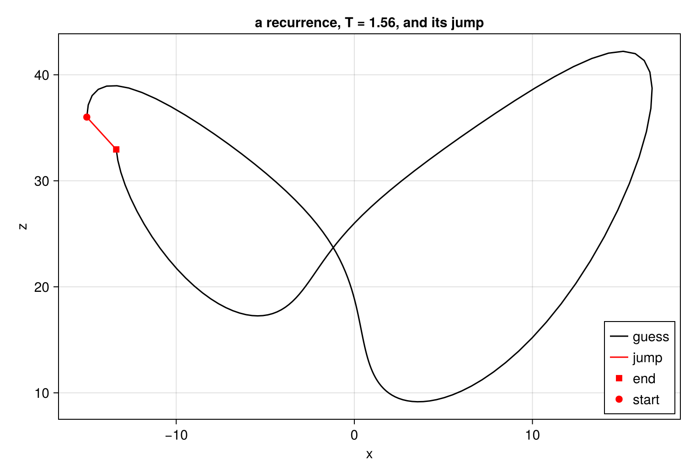

*Figure 1. A recurrence of the Lorenz system, with period $T = 1.56$, in the plane $(x, z)$. The end
of the segment (square) misses its start (circle), and the guess jumps between them (red line).*

The guess is an exact trajectory everywhere except at one place. Where the end meets the start, the
state jumps by $J$, here $\lVert J\rVert = 3.30$. Methods that search for periodic orbits measure
how far a guess is from an orbit by its residual $d\eta/dt - N(\eta)$, with $N$ the vector field. They
compute the derivative in time on a set of instants $\Delta t$ apart over the period, often with the
spectral derivative. The jump spoils this derivative. Figure 2 shows the residual of the guess near
the junction, at four resolutions in time.

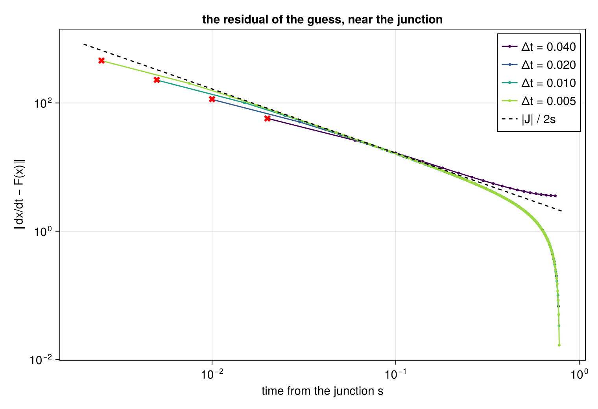

*Figure 2. The residual of the guess of figure 1 against the time $s$ from the junction, by the
spectral derivative over the period, for instants 0.04 to 0.005 apart. Red crosses show
$\ln 2\,\lVert J\rVert/\Delta t$. The dashed line is $\lVert J\rVert/2s$.*

Two facts stand out. At the junction the residual is $\ln 2\,\lVert J\rVert/\Delta t$, 57 for
$\Delta t = 0.04$ and 456 for $\Delta t = 0.005$. It grows without bound as the resolution is refined,
since the derivative of a jump is infinite. Away from the junction the residual decays only as
$\lVert J\rVert/2s$, whatever the resolution. The spectral derivative spreads the error of the jump
over the whole period, and the residual stays above 1 almost everywhere. Both facts follow from the
spectral derivative of a step. At $j$ instants from the jump it is $\lVert J\rVert/\Delta t$ times the
tail of the alternating harmonic series, which is $\ln 2$ for $j = 0$ and about $1/2j$ for large $j$.

## Why not smooth the guess

A simple remedy is to smooth the guess near the junction, with a filter in time or a blend of the end
into the start. The smoothed guess has no jump, and its residual away from the junction falls. But a
smoothed segment is no longer a trajectory. It does not satisfy the equations, and it leaves a
residual wherever the smoothing acts. Nothing makes one smoothing better than another, either. The
filter, its width and its shape are all arbitrary choices. The question is which bridge across the
junction has the smallest residual. This is a problem of optimal control.

## The bridge of least forcing

The bridge lives in a window $-\tau \le t \le \tau$ around the junction. Negative times belong to the
end of the guess, positive times to its start. Let $a$ be the state of the guess at the time $\tau$
before its end, and $b$ its state at the time $\tau$ after its start. A forcing $w f$ is added to the
equations. For a given control $f(t)$, the state is the solution of the initial value problem

$$\frac{d\eta}{dt} = N(\eta) + w(t)\,f(t) , \qquad \eta(-\tau) = a , \qquad
w(t) = \Big(1 - \frac{t^2}{\tau^2}\Big)^3 .$$

Let $\Phi(f) = \eta(\tau)$ be the state that this solution reaches at the end of the window. The map
$\Phi$ takes a control, a function of time over the window, to a single state. Without control,
$\Phi(0)$ is the continuation of the end of the guess, and $\Phi(0) - b$ is the jump carried to the
time $\tau$. The bridge is the solution with the control of least norm that lands on $b$,

$$\text{minimise}\quad E = \frac{1}{2}\int_{-\tau}^{\tau} \lVert f\rVert^2\, dt
\qquad \text{subject to} \qquad \Phi(f) = b .$$

The residual of the bridge, $d\eta/dt - N(\eta)$, is the forcing $w f$. The problem thus asks for the
bridge with the smallest residual, weighted by $1/w^2$, among those that join the two ends. Outside the
window the guess stays the trajectory and has no residual. The window $w$ vanishes at its edges with
its first and second derivatives. The forcing therefore switches on and off smoothly, and the bridge
joins the trajectory with continuous slope and curvature.

## The conditions of the optimum

The equation of the state enters through a multiplier $\lambda(t)$, the adjoint variable. The condition
at the end enters through a multiplier $\nu$, a state like $\eta$. The Lagrangian is

$$\mathcal{L} = \int_{-\tau}^{\tau} \Big[ \frac{1}{2}\lVert f\rVert^2
  + \Big\langle \lambda , \frac{d\eta}{dt} - N(\eta) - w f \Big\rangle \Big]\, dt
  + \big\langle \nu , b - \eta(\tau) \big\rangle ,$$

over the states that start from $a$. At the optimum its variation vanishes for every $\delta\lambda$,
$\delta\nu$, $\delta f$ and $\delta\eta$, with $\delta\eta(-\tau) = 0$. The variation with respect to
$\lambda$ gives back the equation of the state. The variation with respect to $\nu$ gives
$\eta(\tau) = b$. The variation with respect to $f$ is $\int\langle f - w\lambda, \delta f\rangle\,dt$,
which vanishes if $f = w\lambda$. Let $L(\eta)$ be the derivative of $N$ at $\eta$. The variation with
respect to $\eta$, after an integration by parts in time, is

$$\int_{-\tau}^{\tau} \Big\langle -\frac{d\lambda}{dt} - L(\eta)^{\dagger}\lambda , \delta\eta \Big\rangle dt
  + \big\langle \lambda(\tau) - \nu , \delta\eta(\tau) \big\rangle .$$

It vanishes if $\lambda$ obeys the adjoint equation and $\lambda(\tau) = \nu$. The conditions of the
optimum are therefore

$$\frac{d\eta}{dt} = N(\eta) + w f , \quad \eta(-\tau) = a , \quad \eta(\tau) = b , \qquad
\frac{d\lambda}{dt} = -L(\eta)^{\dagger}\lambda , \quad \lambda(\tau) = \nu , \qquad
f = w\lambda .$$

The state has two conditions, one at each end. The adjoint has none, since $\nu$ is unknown. The
condition $\eta(\tau) = b$ determines $\nu$. The control is the window times the adjoint.

## The equations to solve

Two of these conditions hold by construction, once the control and the end of the adjoint are fixed.
Let $x = (f, \nu)$ collect the two unknowns. Given $x$, the state is the solution of the initial value
problem with the control $f$. The adjoint is integrated backward from $\lambda(\tau) = \nu$ along the
state. The two remaining conditions form the system

$$\mathcal{F}(x) = \begin{pmatrix} f - w\lambda \\ \eta(\tau) - b \end{pmatrix} = 0 .$$

The first component is a state at each time of the window. The second is a single state. There are as
many equations as unknowns.

## Newton's method

Newton's method starts from $x^0 = (0, 0)$, with no control. Let $x^k = (f^k, \nu^k)$ be the current
iterate, with its state $\eta^k$ and adjoint $\lambda^k$. A correction $\delta x = (\delta f, \delta\nu)$
changes the state by $\delta\eta$ and the adjoint by $\delta\lambda$, to first order. Newton's method
chooses the correction that makes the linearised system vanish,

$$\begin{pmatrix} f^k - w\lambda^k \\ \eta^k(\tau) - b \end{pmatrix} +
\begin{pmatrix} \delta f - w\,\delta\lambda \\ \delta\eta(\tau) \end{pmatrix} = 0 ,$$

and moves to $x^{k+1} = x^k + \delta x$. Two linear operators give $\delta\eta(\tau)$ and $\delta\lambda$
in terms of $\delta f$ and $\delta\nu$.

**The tangent operator.** The change of the state obeys the linearised equation, forced by
$w\,\delta f$ and zero at the start. The operator $A$ maps the change of the control to the change of
the state at the end. It is the derivative of $\Phi$,

$$\frac{d\,\delta\eta}{dt} = L(\eta^k)\,\delta\eta + w\,\delta f , \qquad \delta\eta(-\tau) = 0 , \qquad
A\,\delta f = \delta\eta(\tau) .$$

$A$ takes a control that depends on time over the window. It returns a single state, at the end.
Applying it costs one integration of the tangent equation forward in time.

**The adjoint operator.** Given a state $v$, let $\lambda_v$ solve the adjoint equation backward in time
from the final condition $v$. The operator $A^\top$ maps $v$ to the window times this adjoint,

$$\frac{d\lambda_v}{dt} = -L(\eta^k)^{\dagger}\lambda_v , \qquad \lambda_v(\tau) = v , \qquad
A^{\top} v = w\,\lambda_v .$$

$A^\top$ takes a single state at the end. It returns a control that depends on time over the window.
Applying it costs one integration of the adjoint equation backward in time. It is the transpose of
$A$. Indeed $\frac{d}{dt}\langle\lambda_v, \delta\eta\rangle = \langle w\lambda_v, \delta f\rangle$ by the
two equations, and the integral over the window gives
$\langle v, A\,\delta f\rangle = \int\langle A^\top v, \delta f\rangle\,dt$.

**The Newton system.** The change of the end is $\delta\eta(\tau) = A\,\delta f$. The change of the
adjoint due to $\delta\nu$ gives $w\lambda_{\delta\nu} = A^\top\delta\nu$. The change of the adjoint due to
the change of the trajectory involves the second derivative of $N$, and it is neglected. This changes
how fast Newton's method converges, not where. The correction thus solves

$$\begin{pmatrix} I & -A^{\top} \\ A & 0 \end{pmatrix}
\begin{pmatrix} \delta f \\ \delta\nu \end{pmatrix}
= -\begin{pmatrix} f^k - w\lambda^k \\ \eta^k(\tau) - b \end{pmatrix} .$$

The first row gives $\delta f = A^\top\delta\nu - (f^k - w\lambda^k)$. In the second row it leaves one
equation for $\delta\nu$,

$$A A^{\top}\,\delta\nu = b - \eta^k(\tau) + A\big(f^k - w\lambda^k\big) .$$

The operator $AA^\top$ maps a state to a state. It is symmetric and positive definite, so conjugate
gradients solve the equation. Each product $AA^\top v$ costs one adjoint and one tangent integration.
The new iterate is $\nu^{k+1} = \nu^k + \delta\nu$ and $f^{k+1} = A^\top\nu^{k+1}$.

The method is Newton's method on the conditions of the optimum, with the Gauss–Newton approximation.
The equation for $\delta\nu$ is that of the Hilbert uniqueness method of exact controllability and of
the representer method of data assimilation. Read as a noise, the forcing makes $E$ a Freidlin–Wentzell
action, and the bridge an instanton. Section 8.5 of the documentation of ReSolverV2.jl, on Kolmogorov
flow, discusses this literature.

## Usage

```julia
using OptimalSmoothing

sol = bridge(Φ, A, Aᵀ, b, f; tol=1e-10, cgtol=1e-6, io=stdout)
```

The problem is given by three functions, with the window inside them.

- `Φ(f)` solves the initial value problem from `a` with the control `f` and returns the state at the
  end. It also fixes the trajectory about which `A` and `Aᵀ` linearise, until the next call.
- `A(δf)` integrates the tangent equation and returns the change of the state at the end.
- `Aᵀ(v)` integrates the adjoint equation from `v` and returns the control `w λ_v`.

States and controls are any objects with `copy`, broadcasting in place with scalars, and a real inner
product `dot`. The result `sol` holds the control `f` and the multiplier `ν`. It also holds the miss and
the residual of the control at each Newton iteration, and the residuals of the conjugate gradients. A
keyword `P` applies a preconditioner for `A Aᵀ`.

## The bridge for the Lorenz system

The script [`examples/lorenz.jl`](examples/lorenz.jl) builds the bridge for the recurrence of figure 1,
with $\tau = 0.2$, and makes all the figures of this page.

```
julia --project=examples examples/lorenz.jl
```

The model is in [`examples/lorenz_model.jl`](examples/lorenz_model.jl). It integrates the equations by
the classical Runge-Kutta scheme of order four, with steps of 0.005. Its `A` and `Aᵀ` are the exact
tangent and transpose of the scheme. The control is sampled at the steps and at the half steps. Its
inner product is that of Simpson's rule, with the weights the scheme gives to the forcing. With these
weights the optimal control is smooth.

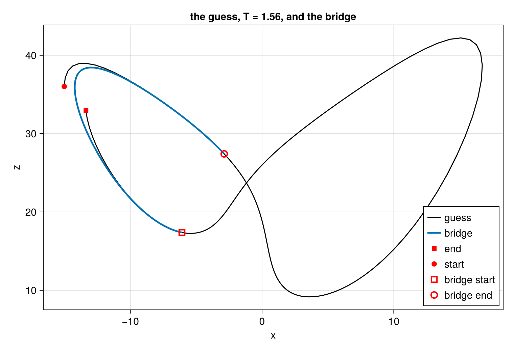

*Figure 3. The guess and the bridge. The bridge (blue) leaves the guess at its start (open square),
0.2 before the end of the segment, and lands at its end (open circle), 0.2 after the start.*

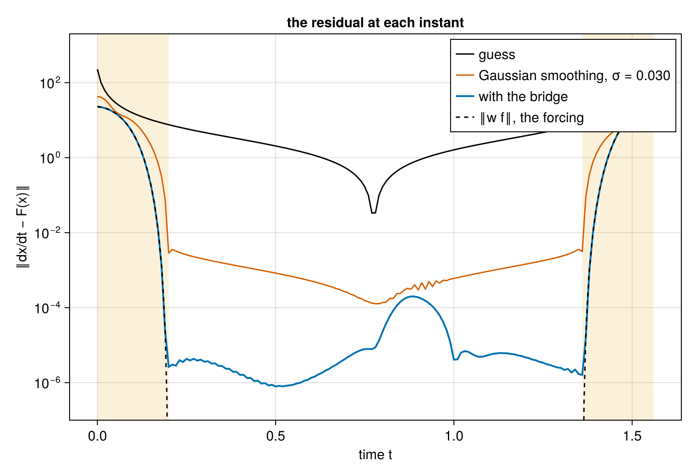

*Figure 4. The residual at each instant, by the spectral derivative over the period on instants 0.01
apart, for the guess, for the guess smoothed by a Gaussian in the same window, and with the bridge.
Dashed, the norm of the forcing $w f$. Shaded, the window.*

With the bridge, the residual inside the window is the forcing $w f$, and the blue curve follows the
dashed one there. The bell of the residual in the window is the control itself. Outside the window
the residual falls to $10^{-6}$ to $10^{-4}$, the error of the resolution in time, against values
above 1 for the guess. Over the period, the root mean square of the residual falls from 31 to 5.9.

The Gaussian smoothing mixes every instant of the guess with its Gaussian average in time, with the
same weight $w$ as the bridge. It removes the jump and joins the guess at the edges of the window, so
it is one of the bridges that the problem compares. The figure shows the best of six widths, a
standard deviation $\sigma = 0.03$. Its residual is larger than that of the bridge almost everywhere
in the window, and outside it stays between $10^{-4}$ and $10^{-2}$. Over the period its root mean
square is 8.6, against 5.9 for the bridge. The bridge minimises the residual weighted by $1/w^2$, not
its root mean square. In that weighted measure the Gaussian smoothing is not even finite, since its
residual does not vanish fast enough at the edges of the window.

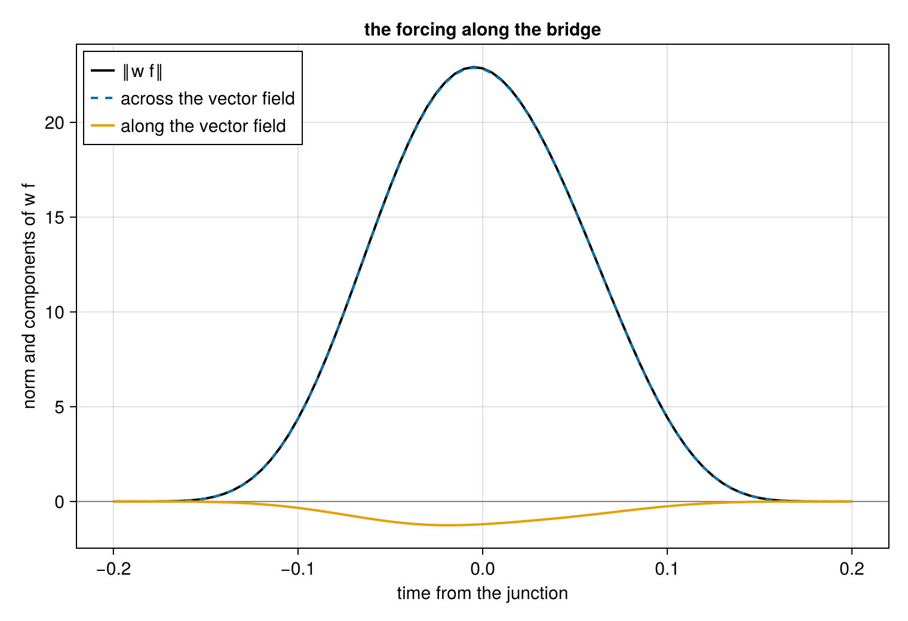

*Figure 5. The norm of the forcing along the bridge, and its components along the vector field and
across it.*

The forcing lies almost entirely across the vector field. Its component along the vector field is
small and negative, and the cosine of the angle stays below 0.16. This is not a property of the
optimum. The conditions of the optimum give $f = w\lambda$, and nothing in them makes $f$ orthogonal
to $N(\eta)$. A push along the vector field moves the trajectory along itself. To first order it
changes the timing of the trajectory, not its shape. For a push $f = \beta N(\eta)$, the tangent
equation gives $\delta\eta(\tau) = \big(\int w\beta\,dt\big)\,N(b)$, a displacement along the flow at
the end. The control needs such a push only if the jump has a component along the flow, a timing
error. Here the recurrence is a local minimum of the distance over the period $T$. There the derivative
of $\lVert x(t + T) - x(t)\rVert^2$ with respect to $T$ vanishes, so
$\langle x(t + T) - x(t), N(x(t + T))\rangle = 0$. The jump is orthogonal to the flow, there is no
timing error, and the forcing is nearly orthogonal to the flow.

The orthogonality is not exact. The component of the adjoint along the flow,
$q = \langle\lambda, N(\eta)\rangle$, is constant along a free trajectory, since $N(\eta)$ solves the
tangent equation. Inside the window it changes at the rate $w^2\langle\lambda, L(\eta)\lambda\rangle$.
The linearised dynamics also mixes the directions across and along the flow, so a push across the flow
shifts the timing a little, and the control compensates this with a small push along the flow. A
strict condition would come from a free period. With $T$ an unknown of the bridge, the optimum in $T$
would add the condition of transversality $\langle\lambda(-\tau), N(a)\rangle = 0$. Since $q$ changes
little, the forcing would then be nearly orthogonal throughout.

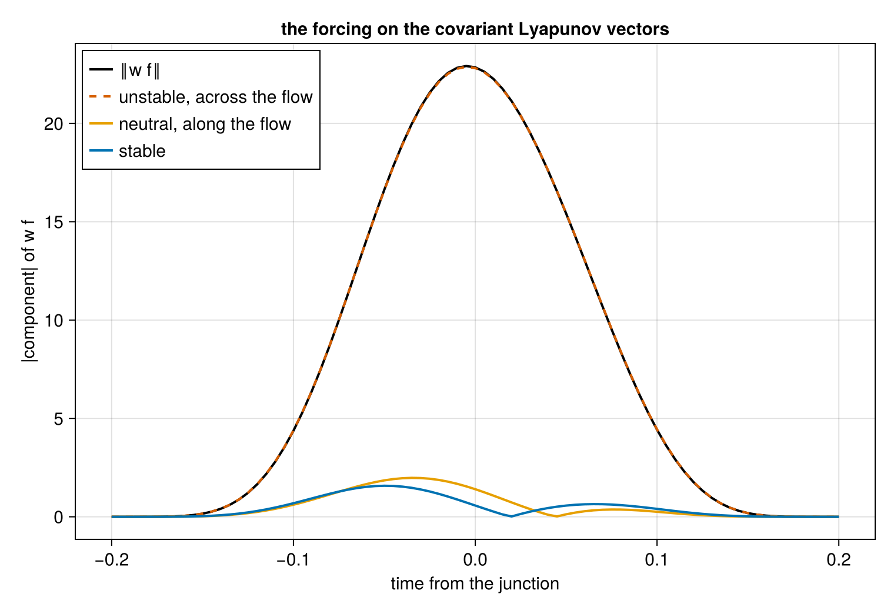

*Figure 6. The forcing on the covariant Lyapunov vectors of the free trajectory through the window.
The components are along the unstable vector made orthogonal to the flow, along the flow, and along
the stable vector.*

The covariant Lyapunov vectors give the directions that the flow stretches and squeezes. The Lorenz
system has three, unstable, neutral and stable. The unstable vector comes from the tangent equation
integrated forward from 10 time units before the window, since every vector turns into it. The neutral
vector is the vector field itself. The stable vector comes from the adjoint equation integrated
backward from 10 time units after the window, with two vectors kept orthonormal. They turn into the
plane of the two leading adjoint vectors, which is orthogonal to the stable vector, so the stable
vector is their cross product. The unstable vector and the vector field span the unstable plane, at
an angle of 28 to 64 degrees here. The forcing is decomposed in this plane, across and along the flow,
and along the stable vector. It lies almost entirely in the unstable plane, across the flow. Its
components along the flow and along the stable vector stay below 2, against a peak of 23. The
cheapest correction is along the unstable direction, which the flow itself amplifies.

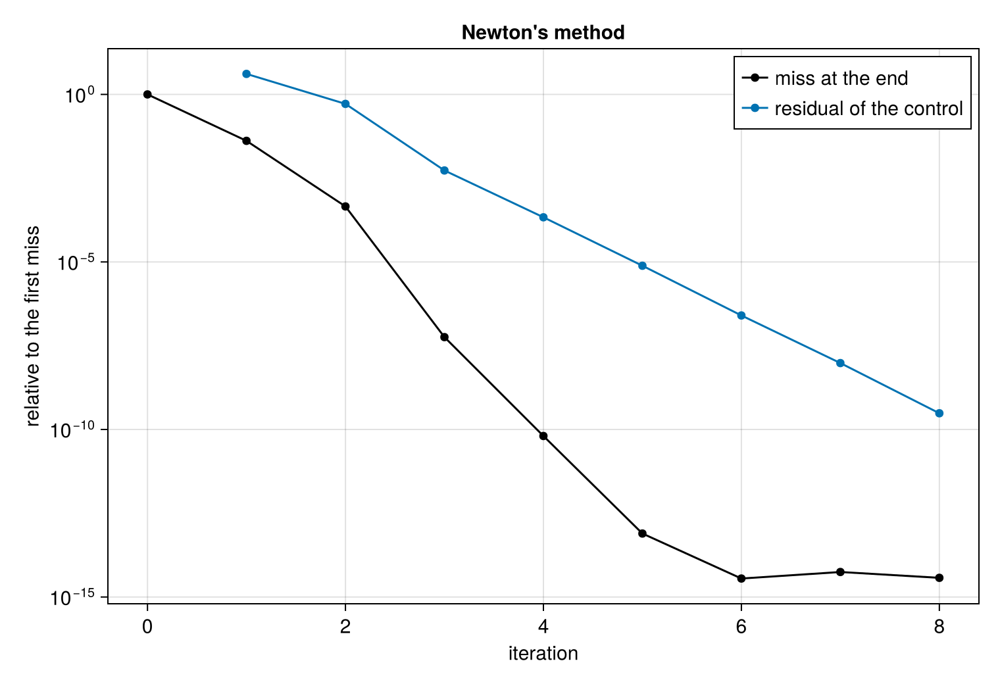

*Figure 7. Newton's method, the miss at the end and the residual of the control, relative to the first
miss.*

The miss at the end falls to $10^{-14}$ of the jump in six iterations. The residual of the control
falls linearly, at the rate set by the neglected second derivative.

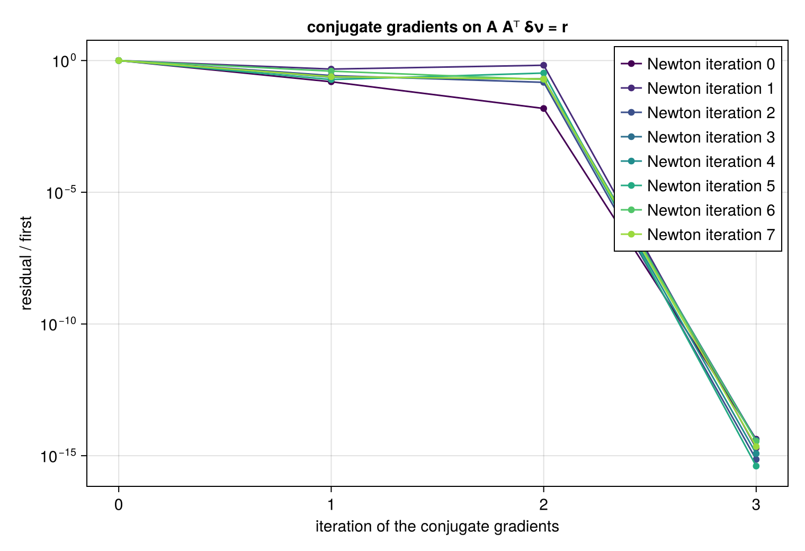

*Figure 8. The residual of the conjugate gradients on $AA^\top\delta\nu = r$ at each Newton iteration,
relative to the first.*

The conjugate gradients converge in three iterations, since the state of the Lorenz system has three
components. For a partial differential equation they converge on the large scales first, and the
small scales call for a preconditioner.

## The width of the window

The window must be shorter than the period, $\tau < T/2 = 0.78$, or its two halves would overlap.
Figures 9 to 13 compare four windows, $\tau$ = 0.05, 0.1, 0.2 and 0.4. Near the upper bound, at
$\tau = 0.75$, the problem becomes strongly nonlinear and Newton's method without a line search
diverges.

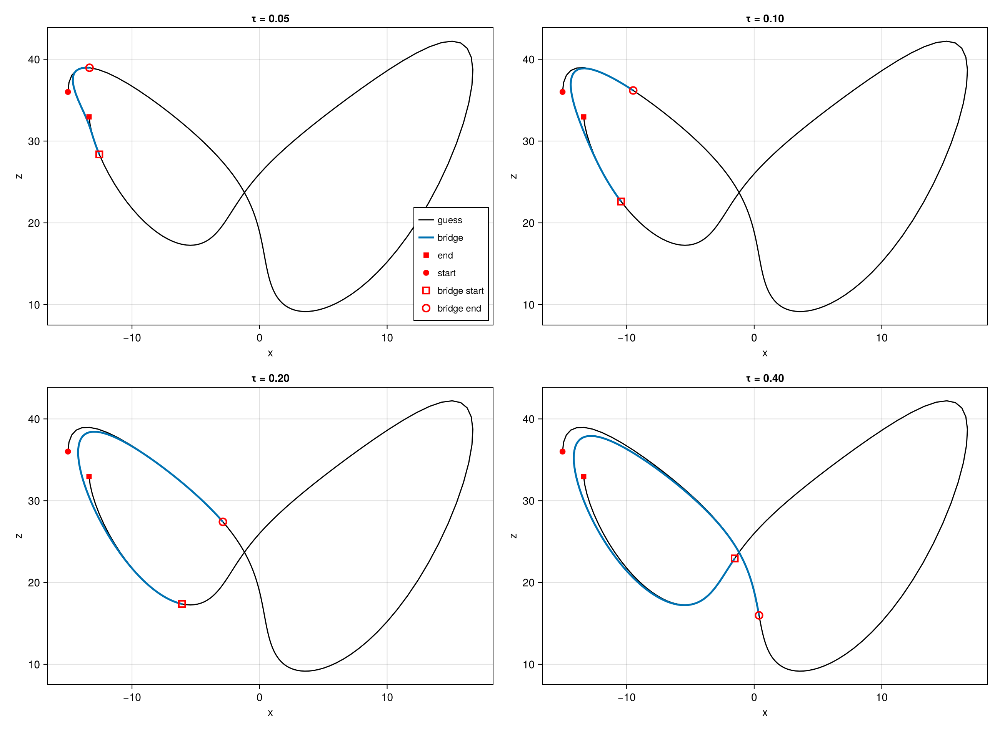

*Figure 9. The guess and the bridge, for the four windows.*

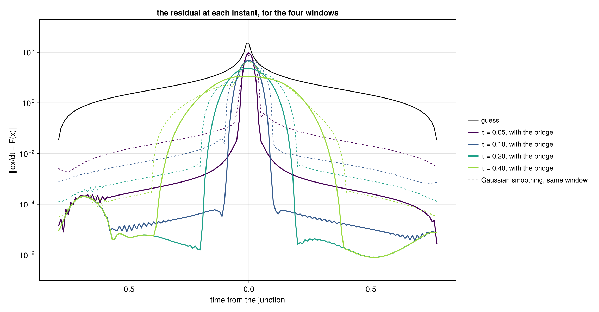

*Figure 10. The residual at each instant against the time from the junction, for the four windows on
one plot. Solid lines show the bridge, and dashed lines of the same colour the Gaussian smoothing in
the same window, with its best width. The black line is the guess.*

As the window grows, the bell of the residual of the bridge widens and lowers, with peaks of 96, 47,
23 and 11. The Gaussian smoothing stays above the bridge almost everywhere, inside and outside the
window.

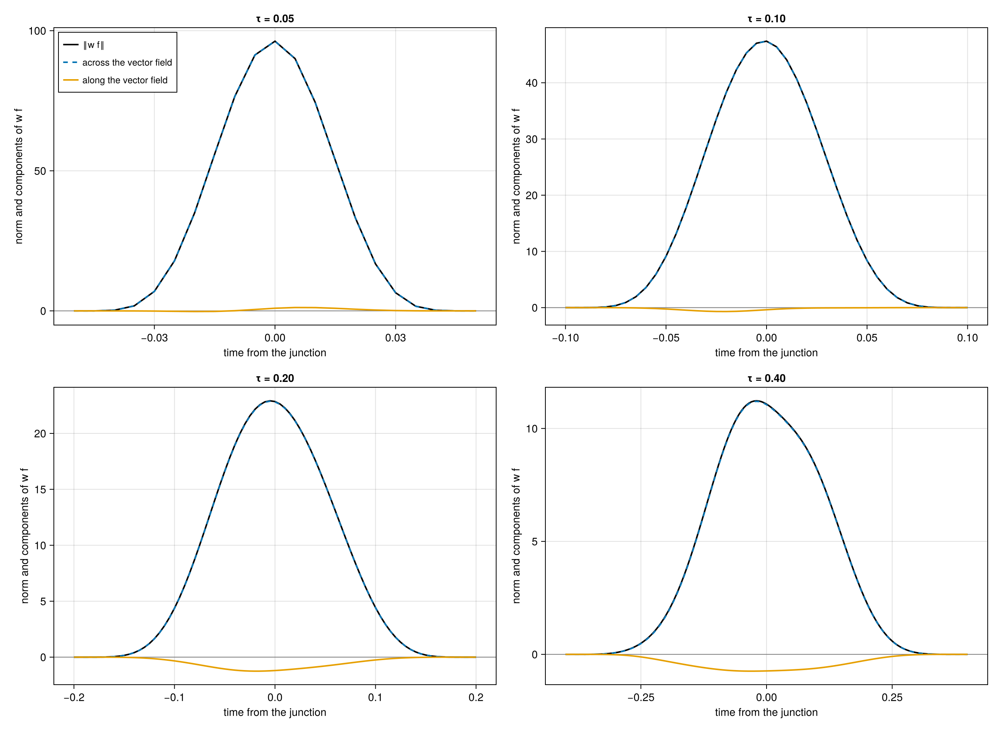

*Figure 11. The forcing and its components along the vector field and across it, as in figure 5, for
the four windows.*

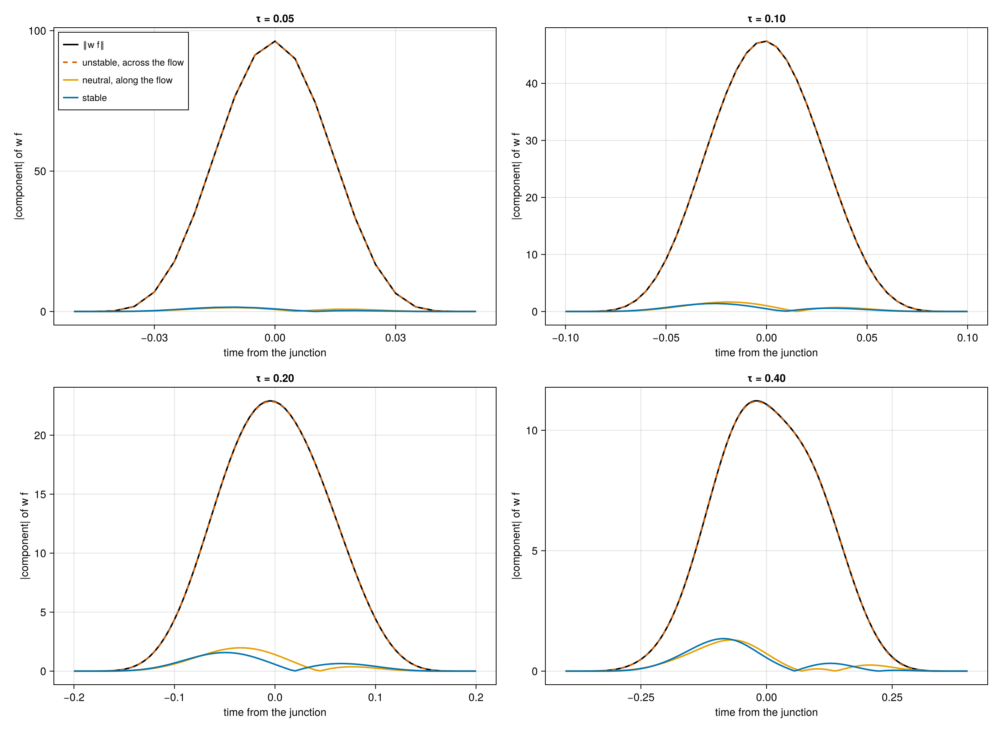

*Figure 12. The forcing on the covariant Lyapunov vectors, as in figure 6, for the four windows.*

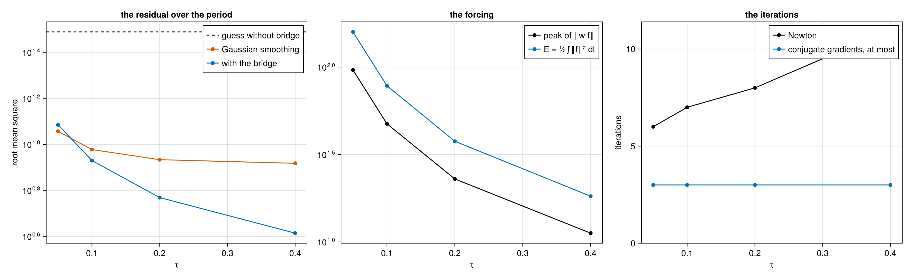

*Figure 13. Against the half-width of the window, the root mean square of the residual over the
period, the peak of the forcing and the energy of the control, and the iterations of Newton's method
and of the conjugate gradients.*

| $\tau$ | Newton | rms, bridge | rms, Gaussian ($\sigma$) | peak of $\lVert wf\rVert$ | $E$ | stable / peak |
|---|---|---|---|---|---|---|
| 0.05 | 6 | 12.2 | 11.4 (0.02) | 96 | 159 | 0.02 |
| 0.10 | 7 | 8.5 | 9.5 (0.03) | 47 | 78 | 0.03 |
| 0.20 | 8 | 5.9 | 8.6 (0.03) | 23 | 38 | 0.07 |
| 0.40 | 11 | 4.1 | 8.3 (0.03) | 11 | 18 | 0.12 |

*Table 1. The bridge for the four windows. The guess without bridge has a root mean square residual
of 31.*

- **The forcing** spreads over the window. Its peak and the energy of the control fall about as
  $1/\tau$, from 96 to 11 and from 159 to 18. A longer window gives the control more time to steer.
- **The residual** of the bridge falls steadily with the window, from 12.2 to 4.1. The Gaussian
  smoothing does not improve with the window. Its best width stays near 0.03 whatever $\tau$, and its
  residual stays near 8. It ignores the dynamics, so a longer window does not help it. Only for the
  shortest window is the Gaussian slightly better in root mean square. There the forcing of the bridge
  is sharp, with a peak of 96, and the instants 0.01 apart barely resolve it, so its residual outside
  the window rises to $10^{-2}$.
- **The direction of the forcing** stays across the flow, along the unstable vector, for every
  window. Its component along the stable vector grows with the window, from 2% to 12% of the peak.
- **Newton's method** needs more iterations for longer windows, 6 to 11, since the problem is more
  nonlinear. The conjugate gradients always converge in three iterations, as the state of the Lorenz
  system has three components.

## The shape of the window

The window $w = (1 - t^2/\tau^2)^3$ is far from flat. The control of least norm is $f = w\lambda$, so the
residual $w f = w^2\lambda$ is concentrated in the middle of the window, where it peaks. A flatter
window spreads the residual over the whole window, and its peak falls. Figures 14 to 17 compare two
families of windows $w = (1 - |t/\tau|^q)^p$. The first is flatter in the middle, with $q$ = 2, 4, 8 and
16 and $p = 3$. Its edges still have zero slope and curvature, but they grow steeper. The second is
less smooth at the edges, with $p$ = 2, 1 and 0 and $q = 2$. The last, $p = 0$, is a box, and its forcing
jumps at the edges.

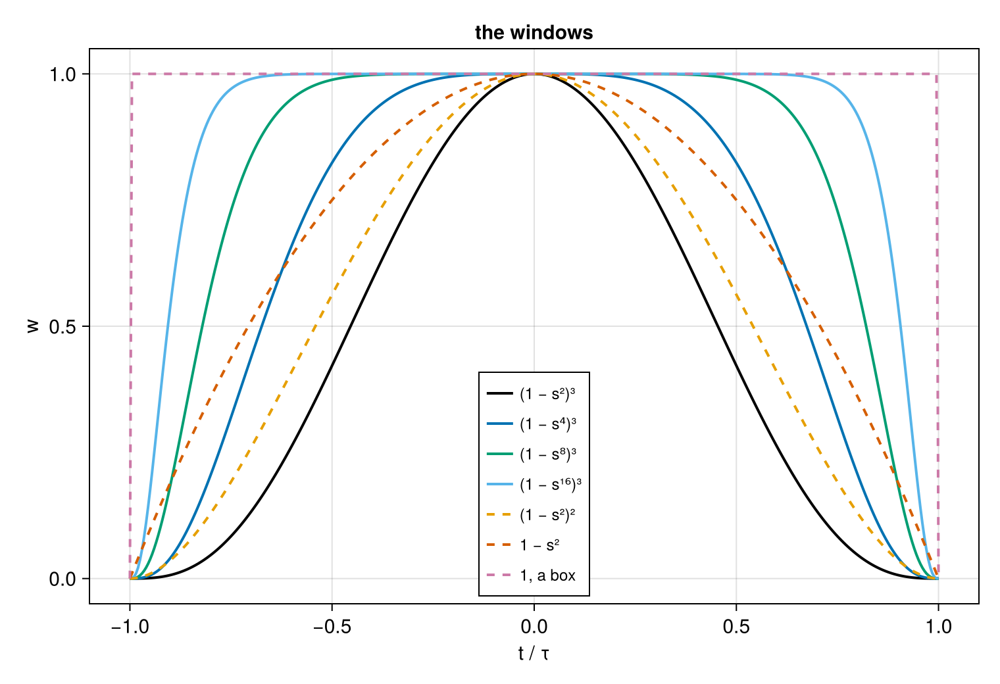

*Figure 14. The windows compared, against $t/\tau$. Solid lines are flatter in the middle, dashed lines
less smooth at the edges.*

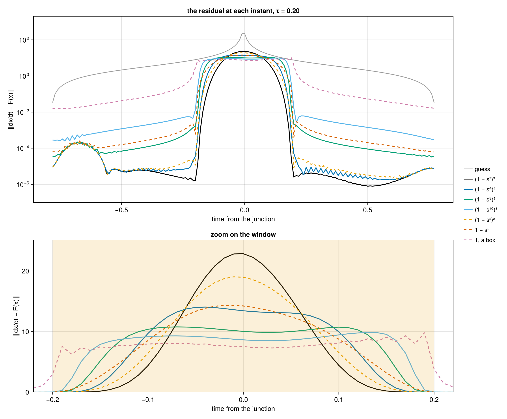

*Figure 15. The residual at each instant for the windows of figure 14, with $\tau = 0.2$, against the
time from the junction. Below, a zoom on the window in a linear scale.*

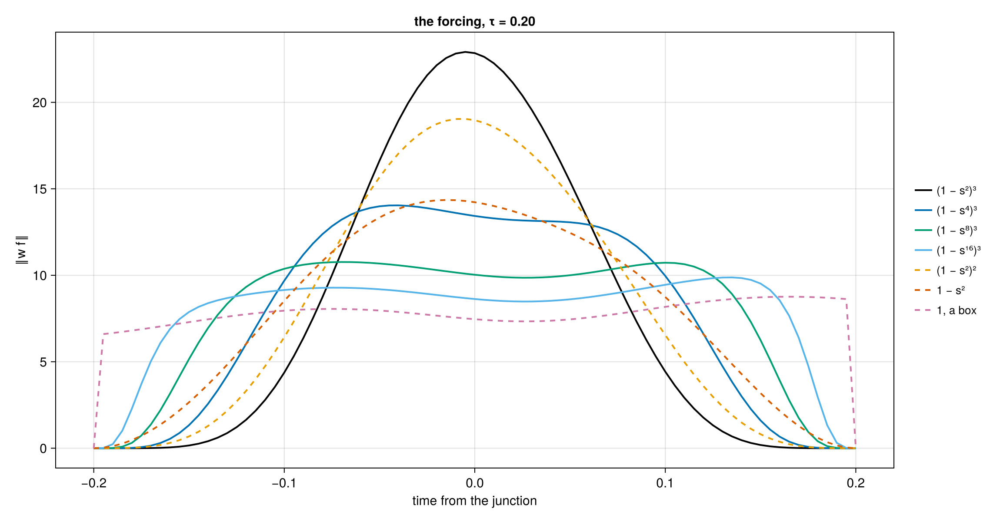

*Figure 16. The norm of the forcing $w f$ for the windows of figure 14, with $\tau = 0.2$.*

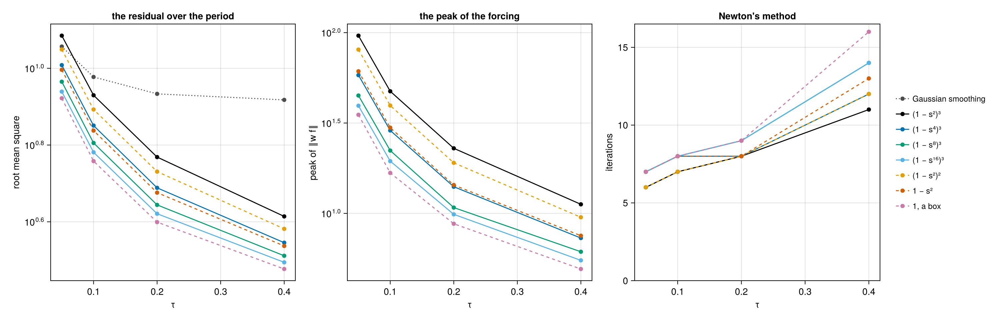

*Figure 17. Against the half-width of the window, the root mean square of the residual over the
period, the peak of the forcing and the iterations of Newton's method, for the windows of figure 14.
Dotted, the Gaussian smoothing with its best width.*

| window | $\tau$ = 0.05 | 0.10 | 0.20 | 0.40 |
|---|---|---|---|---|
| $(1 - s^2)^3$ | 12.2 | 8.5 | 5.9 | 4.1 |
| $(1 - s^4)^3$ | 10.2 | 7.1 | 4.9 | 3.5 |
| $(1 - s^8)^3$ | 9.2 | 6.4 | 4.4 | 3.2 |
| $(1 - s^{16})^3$ | 8.7 | 6.0 | 4.2 | 3.1 |
| $(1 - s^2)^2$ | 11.2 | 7.8 | 5.4 | 3.8 |
| $1 - s^2$ | 9.9 | 6.9 | 4.7 | 3.4 |
| $1$, a box | 8.4 | 5.7 | 4.0 | 3.0 |
| Gaussian smoothing | 11.4 | 9.5 | 8.6 | 8.3 |

*Table 2. The root mean square of the residual over the period, for the windows of figure 14, with
$s = t/\tau$.*

- **Inside the window** the flat windows spread the residual. With $\tau = 0.2$ the first window peaks
  at 23 in the middle. The flat windows stay between 9 and 14 over most of the window.
- **Outside the window** the residual grows with steeper or rougher edges. It is $10^{-6}$ to
  $10^{-5}$ for the first window, $10^{-4}$ to $10^{-3}$ for $(1 - s^8)^3$, and up to 0.5 near the edges
  of the box. The spectral derivative spreads the kinks of the box over the whole period.
- **Over the period** the residual is dominated by the window. The flat windows lower its root mean
  square by 25 to 30% at every width. The box gains a few percent more, at the price of its kinks.
  With a flat window the bridge beats the Gaussian smoothing at every width, the shortest included.
- **Newton's method** needs a few more iterations for flatter or rougher windows, up to 14 and 16 at
  $\tau = 0.4$ against 11.
- **The choice.** A flat window with smooth edges, such as $(1 - s^8)^3$, gives most of the gain. With
  $\tau = 0.2$ its residual is 25% lower, 4.4 against 5.9, its residual outside the window stays below
  $10^{-3}$, and the bridge still joins the trajectory with continuous slope and curvature.

## Future possibilities

The package is a smoothing method for initial guesses, and it can stay simple. Four extensions would
lower the residual further or make the bridge more robust.

- **A free period.** The period of a recurrence is often known only on a coarse grid. Before the
  bridge, it can be refined by minimising the distance between the start and the end over the period,
  on the fine grid of the integrator, with a parabolic fit at the minimum. The jump then has no
  component along the flow. Later, the period can become an unknown of the bridge. It adds one scalar
  to Newton's method and the condition of transversality $\langle\nu, N(b)\rangle = 0$ at the end.
- **A free shift.** For a flow with a continuous symmetry, such as a translation, the same holds for
  the shift between the start and the end.
- **A continuation in the width.** Long windows lower the residual but make Newton's method diverge.
  Starting from a short window and widening it a little at a time would reach long windows safely. At
  $\tau = T/2$ the window covers the whole period and the bridge becomes a closed loop with the least
  forcing. With its anchor point and its period free as well, the forcing vanishes on a periodic orbit.
  The continuation would then lead from a recurrence to a periodic orbit.
- **A line search.** Halving the Newton step until the miss decreases would make the method robust
  far from the solution.

## Tests

```
julia --project -e 'using Pkg; Pkg.test()'
```

The tests check the control of least norm against its closed form for a linear map. For the Lorenz
system they check the transpose and that the bridge lands on its target.
